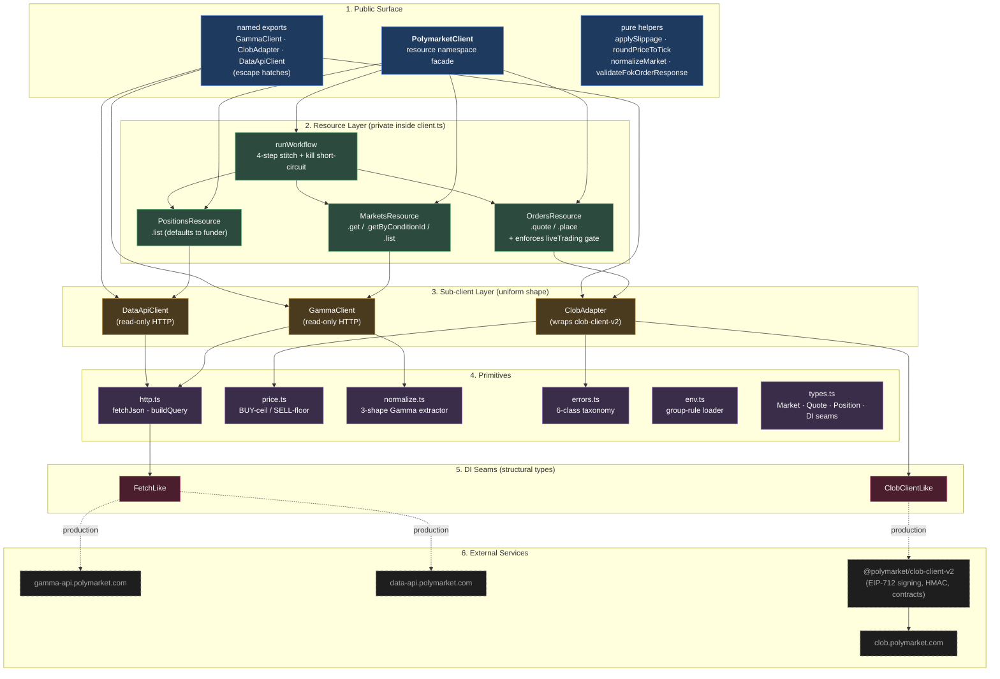

# design.md

Design rationale for `@poly-unified/sdk`. The full long-form attribution lives in [`reference.md`](./reference.md). This is the condensed version.

---

## The problem

Polymarket's developer surface is fragmented across three hosts, two auth layers, and a handful of off-band concepts:

| Host                       | Owns                                                                |
| -------------------------- | ------------------------------------------------------------------- |
| `gamma-api.polymarket.com` | Markets, events, slugs, outcomes, `clobTokenIds`                    |
| `clob.polymarket.com`      | Orderbook, `calculateMarketPrice`, order placement, EIP-712 signing |
| `data-api.polymarket.com`  | Positions, activity, value                                          |

To complete the four-step journey (fetch → quote → place → view positions), a developer currently has to know nine plumbing concepts (conditionId vs clobTokenId, sigType 2 vs others, FOK `amount` flipping by side, worst-price `cap` semantics, neg-risk routing, tick rounding direction, cred derivation, etc.).

What I'm trying to do here is build a unified surface that hides this without pretending the concepts don't exist. That tension drives every decision below.

---

## Design pillars

1. **Workflow-first surface, service-second:** The four resource methods are the headline. Sub-clients exist as escape hatches.
2. **Don't pretend concepts don't exist:** `Market.outcomes`, `Market.tickSize`, `Market.negRisk`, `Quote.feeUsd` all surface the underlying concepts. I just resolve them once at the boundary.
3. **Default-safe:** Live trading requires double-gating. Dry-run is a first-class mode.
4. **Testable by construction:** Every external integration sits behind a structurally-typed seam (`ClobClientLike`, `FetchLike`).
5. **Tolerant on input, strict on output:** Gamma payloads are messy; I normalize at the edge into stable types. Errors are named subclasses, never strings.

---

## Architecture

Six layers, dependencies flowing downward.



Rules of the architecture:

- Each layer only depends downward.
- Resources never bypass sub-clients.
- Sub-clients never call each other. The facade is the only place that orchestrates across services.
- DI seams are the only place where production and test-time differ. Tests inject `ClobClientLike` and `FetchLike` fakes via `PolymarketClient.fromDependencies(...)`; production wires real `ClobClient` and `globalThis.fetch` via `PolymarketClient.create(...)`.

### The journey, top to bottom

Here's `runWorkflow` running the four-step happy path as a call tree. Indentation = call depth. Renders identically in any markdown viewer.

```text
Caller
  └─ PolymarketClient.runWorkflow({ slug, outcome, side, amount, confirm: true })
      │
      ├─ STEP 1: Fetch market
      │    └─ GammaClient.getBySlug(slug)
      │         └─ GET gamma-api.polymarket.com/markets/slug/:slug
      │              └─ returns: Market { outcomes, tickSize, negRisk, raw }
      │
      ├─ STEP 2: Quote
      │    └─ ClobAdapter.quoteFok(market, outcome, side, amount)
      │         ├─ clob-client-v2.calculateMarketPrice(tokenId, side, amount, FOK)
      │         │    └─ GET clob.polymarket.com (internally)
      │         │         └─ returns: number (avgPrice)
      │         └─ applySlippage + roundPriceToTick
      │              └─ returns: Quote { avgPrice, worstPrice, expectedShares, feeUsd }
      │
      ├─ STEP 3: Place (quote precomputed, no re-quote)
      │    └─ ClobAdapter.placeFok(quote, args)
      │         ├─ enforce enableLiveTrading gate
      │         │    └─ ⚠ LiveTradingNotEnabledError if disabled
      │         ├─ clob-client-v2.createMarketOrder(UserMarketOrderV2, options)
      │         │    └─ EIP-712 sign with sigType 2 + funder
      │         │         └─ returns: SignedOrder
      │         ├─ clob-client-v2.postOrder(signed, OrderType.FOK)
      │         │    └─ POST clob.polymarket.com/order
      │         │         └─ returns: OrderResponse { success, status, orderID, ... }
      │         └─ validateFokOrderResponse
      │              └─ ⚠ OrderPlacementError on failure → short-circuits STEP 4
      │                  returns: OrderReceipt on success
      │
      └─ STEP 4: Positions (skipped on placement failure)
           └─ DataApiClient.list({ user, market })
                └─ GET data-api.polymarket.com/positions?user=...
                     └─ returns: Position[] (snake/camel normalized)

returns: RunWorkflowResult { kind: 'live', market, quote, receipt, positions }
```

The kill short-circuit is the only flow-control subtlety. If step 3 throws `OrderPlacementError` (postOrder returned `success: false` or a `failed/killed/rejected/canceled` status), step 4 is skipped because the next `await` line in `runWorkflow` never runs. That prevents "positions look fine, must have worked" false-success readings on a failed trade.

---

## Three load-bearing decisions

### 1. Resource-oriented namespace (Stripe shape)

`PolymarketClient` is a **facade** over three back-end services. The choice in this section isn't whether to use a facade. Every option I considered was a facade. The real choice is how to *organize* the facade's surface. I went with Stripe shape: methods live on resource sub-objects (`client.markets`, `client.orders`, `client.positions`), not flat on the client itself.

```ts
client.markets.get / .getByConditionId / .list
client.orders.quote / .place
client.positions.list
client.runWorkflow            // top-level orchestration shortcut
```

**Why resource namespacing, not flat methods directly on the class?**
A flat-method facade (`client.placeMarketOrder()`, `client.fetchMarket()`, `client.listPositions()`) doesn't scale. Adding `cancelOrder`, `getOpenOrders`, `listEvents` later makes it a junk drawer. Resources mirror Polymarket's REST organization (`/markets/`, `/orders/`, `/positions/`) so docs-to-SDK mapping is 1:1, and the namespace stays clean as the surface grows.

**Why not three separate sub-clients (the `polymarket-kit` shape)?**
That's the prior art. It exposes `GammaSDK`, `PolymarketSDK`, `DataSDK` separately but explicitly lacks orchestration. The reviewer of that library noted "a user must manage three client instances and pass data between them manually." The facade layer is the gap that prior art didn't fill.

**Why also export the sub-clients?**
Because the journey is four methods. Cancellations, open-order listing, event browsing, and everything else needs an escape hatch. Hiding the sub-clients would violate the "don't pretend concepts don't exist" pillar. So the public surface is: facade for the journey + named sub-client exports for everything else, with `ClobAdapter` adapting `clob-client-v2` to my internal types/errors underneath.

### 2. Smoke + `dryRun: true`

The smoke script (`npm run smoke`) hits Gamma + CLOB pricing + Data API positions end-to-end with zero money. The `dryRun: true` mode on `orders.place` calls `createMarketOrder` (real EIP-712 signing) but never `postOrder`, returning the signed payload for inspection.

**Why both?** Different bug classes:
- The fake-CLOB unit tests prove the code shape. They can't catch sigType wiring, funder mismatches, EIP-712 domain issues, or tick precision rounding errors. Those manifest only against the real signer + chain.
- The smoke script exercises every integration boundary the journey touches, without spending money.
- `dryRun` is also useful in production (inspect a payload before committing).

The existing prototype I referenced (the `PolymarketWorkflowClient`) shipped a real-trade `examples/trade.ts` *and* no smoke. That's worst-of-both: a footgun and no way to verify integration. I replace both with the smoke + dryRun pair.

### 3. Two-gate live-trading guard

```ts
type PlaceOrderArgs =
  | { dryRun: true;  confirm?: never; ... }    // dryRun mode
  | { dryRun?: false; confirm: true;  ... };   // live mode (literal `true`)
```

Plus a runtime check: if `dryRun !== true` and `enableLiveTrading` is false, throw `LiveTradingNotEnabledError` before signing.

**Why two gates?** They answer different questions:
- `confirm: true` literal type: *"does this code intend to trade?"* (call site, compile-time).
- `enableLiveTrading` env/config: *"is this environment authorized to trade?"* (construction, runtime).

A literal-only gate doesn't survive a hardcoded `confirm: true` in a script intended for staging that's run against a mainnet wallet. An env-only gate is invisible at the call site. Both together close both holes.

The literal-`true` type is borrowed from AWS CDK's `requireApproval` and `rm --no-preserve-root`. Friction at exactly the moment that matters. TypeScript rejects `confirm: false`, missing confirm, and `confirm: someBoolean`.

---

## Internal patterns

| Pattern                                                                                               | Why it earned its place                                                                                                                                                               |
| ----------------------------------------------------------------------------------------------------- | ------------------------------------------------------------------------------------------------------------------------------------------------------------------------------------- |
| `ClobClientLike` + `FetchLike` DI seams + dual `.create()` / `.fromDependencies()` constructors       | Vitest runs zero network and zero signing. Every code path is exercised against fakes.                                                                                                |
| Tolerant Gamma normalization (3 response shapes, JSON-stringified arrays, snake/camel, raw preserved) | Polymarket's Gamma genuinely returns inconsistent shapes. Tolerance at the edge keeps the rest of the codebase simple.                                                                |
| BUY-ceil / SELL-floor tick rounding with `[tickSize, 1]` clamp                                        | Worst-price never improves on the slippage band. Naive round-to-nearest silently shrinks the slippage cap.                                                                            |
| Named error taxonomy (`PolymarketWorkflowError` parent + 6 subclasses)                                | `instanceof` discrimination beats string-matching. Each carries structured fields (status, body, candidates, available outcomes).                                                     |
| `validateFokOrderResponse` short-circuit                                                              | `runWorkflow` never calls `positions.list` after a killed order. Prevents "positions look fine, must have worked" false-success readings.                                             |
| `ClobAdapter` wraps `clob-client-v2` rather than re-exporting                                         | Insulates users from the underlying SDK's quirks (default-no-throw error mode, string-typed prices). All three sub-clients share a uniform shape.                                     |
| `runWorkflow` passes its computed quote into `orders.place`                                           | Eliminates a redundant `calculateMarketPrice` round-trip. Also prevents the displayed quote from diverging from the actually-signed worst-price if the orderbook moves between calls. |

---

## A note on credential handling: derive-first, not `createOrDeriveApiKey`

I deliberately deviate from Polymarket's official quickstart pattern here. Worth explaining because at first glance it looks like I'm just not using the convenience method.

### The official pattern (from quickstart)

```ts
const tempClient = new ClobClient({ host, chain, signer });    // no throwOnError
const creds = await tempClient.createOrDeriveApiKey();         // single convenience call
const realClient = new ClobClient({ host, chain, signer, creds, signatureType, funderAddress });
```

### What `clob-client-v2`'s `createOrDeriveApiKey` *actually* does

Source from `node_modules/@polymarket/clob-client-v2/dist/index.js`:

```js
async createOrDeriveApiKey(nonce) {
  return this.createApiKey(nonce).then((response) => {
    if (!response.key) {
      return this.deriveApiKey(nonce);
    }
    return response;
  });
}
```

It tries `createApiKey` **first**. The fallback to `deriveApiKey` only fires when the response object has no `.key`. The Polymarket docs describe this method as *"attempts derivation first; falls back to creation if needed"*, which is the opposite of what the implementation does.

### Why this matters for me

I set `throwOnError: true` everywhere for strict, uniform error semantics. With that flag:

- A 400 "Could not create api key" (returned when a key already exists for the wallet at the requested nonce) **throws** an `ApiError` synchronously inside `createApiKey`.
- The `.then(response => …)` fallback never runs.
- `createOrDeriveApiKey` becomes effectively just `createApiKey`, and fails for any returning wallet.

### My derive-first approach

```ts
if (creds === undefined) {
  try {
    creds = await clobClient.deriveApiKey(0);   // returning wallet: returns existing key
  } catch {
    creds = await clobClient.createApiKey(0);   // first-time wallet: creates new key
  }
}
```

Three reasons this is the right call:

1. **Matches the documented intent:** This is what `createOrDeriveApiKey` *claims* to do (per the Polymarket docs). My code implements that contract correctly; the SDK's actual implementation doesn't.
2. **Robust to `clob-client-v2` changes:** If they fix the ordering bug or rewrite the dead-code fallback, my code still works.
3. **Avoids a non-obvious destructive side effect:** The docs note: *"Each wallet can only have one active API key at a time. Creating a new key invalidates the previous one."* If `createOrDeriveApiKey` ever *does* succeed at create-first (e.g., with `throwOnError: false`), it can silently rotate an active key, breaking any other process holding the old one. Derive-first never has this risk.

The cost: about 5 lines of code and one paragraph of explanation. The benefit: zero-config setup for any reviewer with a previously-onboarded wallet, no destructive cred rotation, and a defensible deviation from the docs that's actually *more correct* than the docs.

---

## Open questions

- **Position settlement timing:** After a successful FOK, Data API positions may not reflect the trade for a few seconds (`MATCHED → MINED → CONFIRMED`). The smoke script will surface this empirically; expect a brief poll loop in the live example if needed.
- **Tick size source:** Gamma returns `orderPriceMinTickSize`; CLOB has `getTickSize`. I prefer Gamma. If they diverge in production, CLOB is authoritative.
- **Fee transparency:** `Quote.feeUsd` is a best-effort estimate using a 2% default rate; actual fees come from the matching engine. Should I surface the rate per-market via `getFeeRateBps`? Tentatively no, because it's an extra round-trip for every quote.
- **API cred caching:** In-memory only. Disk persistence needs encryption-at-rest scope I'm not solving. Caller can pass pre-derived creds via env.

---

## What I learned from other SDKs

- **Stripe:** consistency across the abstraction ladder; inspectability (`dryRun`); progressive complexity.
- **CCXT:** normalize the data shape across heterogeneous backends; uniform adapter shape.
- **viem:** avoid the word "Signer" (I use `Account` / `WalletClient`).
- **Hyperliquid:** symbol/outcome-keyed market orders, not raw token IDs.
- **Refactoring.guru:** facade + adapter coexist at different layers (facade over services, adapter over `clob-client-v2`).
- **`polymarket-kit`:** the orchestration gap their architecture didn't fill is the gap my facade fills.

Full attribution and source links: [`reference.md`](./reference.md).
