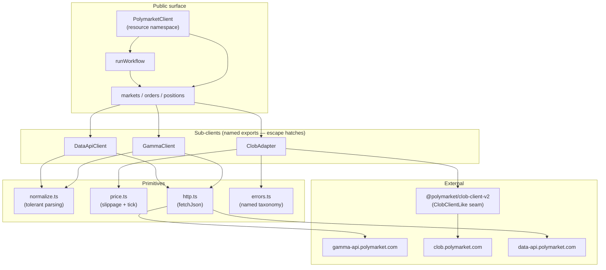

# feat: Polymarket Unified TypeScript SDK prototype

## Summary

Build a small Node.js TypeScript SDK that hides Polymarket's three-service fragmentation behind a Stripe-style resource namespace while keeping each underlying service (`GammaClient`, `ClobAdapter`, `DataApiClient`) accessible as a named export escape hatch. Surface is the four-step journey: fetch a market by slug, quote an FOK market order, place it under a double-gated guardrail (compile-time literal `confirm: true` + runtime `enableLiveTrading` env gate), and read positions back. Internals reuse the strongest patterns from the existing `PolymarketWorkflowClient` prototype — DI seams, tolerant Gamma normalization, named error taxonomy, BUY-ceil/SELL-floor tick rounding, response-validation short-circuit — and add the two patterns that prototype lacked: a read-only smoke script and a `dryRun: true` mode that signs without submitting.

---

## Problem Frame

Polymarket's developer surface is split across three hosts (`gamma-api`, `clob.polymarket.com`, `data-api`) with three concept models, two auth layers (L1 EIP-712 → derive creds → L2 HMAC), and two off-band concepts (Safe proxy address as `funder`, `signatureType: 2`). To complete the four-step journey a developer currently has to learn nine plumbing concepts (conditionId vs clobTokenId, outcome→token mapping, FOK `amount` flipping by side, worst-price `cap` semantics, neg-risk routing, tick rounding, cred derivation, etc.). The take-home assignment explicitly asks for a unified surface that hides fragmentation *without* pretending the concepts don't exist — and an existing prototype `PolymarketWorkflowClient` solves part of this but exposes no escape hatches and ships no smoke test or dryRun mode. Full reasoning, attribution, and external SDK lessons are in `reference.md`.

---

## Requirements

- R1. Single facade `PolymarketClient` exposing the four-step journey via Stripe-style resource namespace (`markets.get`, `orders.quote`, `orders.place`, `positions.list`, plus top-level `runWorkflow`).
- R2. Named exports of uniform sub-clients `GammaClient`, `ClobAdapter`, `DataApiClient` so callers can drop down for off-journey operations.
- R3. Double-gated live trading: discriminated union forcing `{ dryRun: true } | { confirm: true (literal), dryRun?: false }` at compile time, plus runtime `enableLiveTrading` env/config gate scoped to live submission only.
- R4. `dryRun: true` mode signs the EIP-712 payload via `clob.createMarketOrder` but does not call `postOrder`; returns the signed payload for inspection.
- R5. Tolerant Gamma normalization handling three response shapes (single market, market list, event-with-nested-markets), JSON-stringified arrays, snake/camel fallback, raw payload preserved on every result.
- R6. Named error taxonomy: `PolymarketWorkflowError` parent with `PolymarketApiError(status, body)`, `MarketAmbiguityError`, `MissingOutcomeError`, `LiveTradingNotEnabledError`, `OrderPlacementError`, `DryRunBlockedError` subclasses.
- R7. Tick rounding direction: BUY ceils, SELL floors so worst-price never improves on the slippage band; clamp to `[tickSize, 1]`.
- R8. Response validation: `validateFokOrderResponse` rejects `success: false`, non-empty `errorMsg`, or any `failed/killed/rejected/canceled` status. `runWorkflow` short-circuits before `getPositions` on rejection.
- R9. DI seams: `ClobClientLike` and `FetchLike` structurally typed; dual constructors `PolymarketClient.create(config)` for production and `PolymarketClient.fromDependencies(deps)` for tests.
- R10. Read-only smoke script (`scripts/smoke.ts`) exercises Gamma + CLOB pricing + Data API positions end-to-end with zero money. Optionally exercises `dryRun` mode.
- R11. Three documentation deliverables — `readme.md` (quickstart + journey), `design.md` (rationale + tradeoffs), `ai-usage.md` (how AI/agents were used). Plus `reference.md` already in repo as long-form personal reference.
- R12. Node ≥ 20, TypeScript strict, ESM-only, vitest, no real network or signing in unit tests.

---

## Scope Boundaries

- WebSockets, real-time streams (WS is a different ergonomic problem).
- GTC/GTD/FAK order types, batch orders, cancellations, post-only — caller drops to `ClobAdapter`.
- Browser support, CORS workarounds (assignment is Node-only).
- `signatureType` 0/1/3 — sigType 2 is the default; constructor accepts override but example/smoke flows assume 2.
- Multi-chain — Polygon mainnet only.
- Deposits/withdrawals (Bridge), neg-risk redemptions/merges/splits.
- Rate-limit retry framework, balance preflight, automated CI integration tests against live APIs.
- Schema-first codegen (à la `polymarket-kit`'s TypeBox approach) — hand-normalize at the edge instead.

---

## Context & Research

### Relevant Code and Patterns

- Existing prototype `PolymarketWorkflowClient` and walkthrough — used as primary architectural reference for internals (DI, normalization, errors, tick math, env loader). See `reference.md` §5 and §8 attribution table.
- `@polymarket/clob-client-v2` — underlying CLOB wrapper. Public methods we use: `createOrDeriveApiKey`, `getTickSize`, `getNegRisk`, `calculateMarketPrice`, `createMarketOrder`, `postOrder`, `getOrderBook`. Quirks: default `throwOnError: false` returns `{ error, status }` objects; two-step credential init.
- `@polymarket/clob-client-v2` types: `Side`, `OrderType.FOK`, `SignatureType.POLY_GNOSIS_SAFE` (numeric 2), `ApiKeyCreds`, `OrderBookSummary`, `UserMarketOrder`, `CreateOrderOptions`.

### Institutional Learnings

- None — fresh repo. Reference doc captures the take-home's external research synthesis instead.

### External References

- `reference.md` (in repo) — full attribution and source links. Key external lessons: Stripe (consistency across abstraction ladder, inspectability, progressive complexity), CCXT (data-shape normalization, uniform adapter shape), viem (Account terminology, no custom Signer), Hyperliquid (symbol/outcome-keyed market orders), Refactoring.guru (facade vs adapter at different layers).

---

## Key Technical Decisions

- **Resource-oriented namespace (Alternative B)**: `client.markets.get` / `client.orders.quote` / `client.orders.place` / `client.positions.list`. Maps 1:1 to Polymarket REST organization. Scales gracefully when `orders.cancel`/`orders.list` are added later. Alternatives rejected: flat methods, layered core+journeys, builder/fluent — see `reference.md` §5.1.
- **Uniform sub-client shape**: All three sub-clients (`GammaClient`, `ClobAdapter`, `DataApiClient`) share a parallel constructor (`{ fetch?, baseUrl?, ... }`), throw named errors (no `Result<T>` types), return normalized types with `raw` field preserved. `ClobAdapter` *wraps* `clob-client-v2`'s `ClobClient` to insulate users from its quirks (default-no-throw error mode, string-typed prices).
- **Discriminated union for `orders.place`**: `{ dryRun: true } | { dryRun?: false, confirm: true }` rejects `confirm: someExpression`, rejects missing `confirm` in live mode, rejects redundant `confirm` in dryRun mode — all at compile time.
- **Two-gate live-trading guard (different questions)**: `confirm: true` literal at call site = "this code intends to trade"; `enableLiveTrading` env/config = "this environment is authorized to trade". Both must hold for a live submission. dryRun bypasses both.
- **DI via structural typing (`ClobClientLike`, `FetchLike`) + dual constructors**: `.create(config)` builds the real viem signer, derives creds, instantiates `ClobClient`. `.fromDependencies(deps)` accepts pre-built fakes. Vitest runs zero network and zero signing.
- **Tolerant input, strict output**: Gamma payloads parsed with field-level fallback (snake/camel, JSON-stringified arrays, market-vs-event field hoisting). Normalized output types are strict and stable. Raw payload preserved as an escape hatch for fields the SDK doesn't surface.
- **Tick rounding direction encoded in the math**: `roundPriceToTick(price, tickSize, side)` ceils for BUY, floors for SELL. Worst-price never improves on the slippage band.
- **API cred caching**: in-memory only by default. If caller passes pre-derived creds via constructor or env, those are used directly. No disk cache (avoids encryption-at-rest scope).
- **Polygon + sigType 2 hardcoded as defaults, configurable via override**: matches the take-home scenario without ruling out advanced use.
- **No `Result<T>` / no-throw API**: un-idiomatic for TS. Named error subclasses give the same discrimination via `instanceof`.

---

## Open Questions

### Resolved During Planning

- *Package shape*: facade + uniform sub-client exports with resource-oriented namespace (Alternative B). Resolved against cheapest-implementation, layered, hidden-only, and builder alternatives. See `reference.md` §5.1.
- *Smoke + dryRun*: both included. Smoke for read paths, dryRun for write path without spending.
- *Real-money guardrail*: discriminated union (compile time) + env gate (runtime), bypassed by `dryRun`.
- *API cred caching strategy*: in-memory only for v0; no disk persistence.
- *Outcome by name vs raw `tokenId`*: outcome name is the journey input; raw tokenId remains accessible via the `Market` object.

### Deferred to Implementation

- *Position settlement timing after FOK*: docs say "atomic" but trade lifecycle has `MATCHED → MINED → CONFIRMED`. Resolve during smoke testing — may need a brief retry-on-empty-positions in the example, or a doc note. Not a code path in v0.
- *Tick size source agreement*: prefer Gamma `orderPriceMinTickSize`, fall back to CLOB `getTickSize(tokenId)` if missing. Verify they always agree during smoke testing; if they diverge, document and pick CLOB as authoritative.
- *Fee transparency in quote*: `reference.md` §7 raises this as an open question. Tentatively include a `feeUsd` estimate in the `Quote` type using the documented `C × feeRate × p × (1-p)` formula. Decide for sure during U5 implementation.
- *Exact `runWorkflow` input shape*: stitch-specific input combining slug + outcome + side + amount, vs reusing `orders.place` args. Defer until U7 — likely a stitch-specific type for clarity.

---

## Output Structure

```text
poly-unified-sdk/
├── package.json
├── tsconfig.json
├── vitest.config.ts
├── .env.example
├── .gitignore
├── readme.md                    (only doc at repo root, npm convention)
├── docs/
│   ├── design.md
│   ├── ai-usage.md
│   ├── reference.md             (long-form personal reference)
│   └── plans/
│       └── 2026-04-29-001-feat-poly-unified-sdk-plan.md   (this file)
├── src/
│   ├── index.ts                 # public exports (facade + sub-clients + types + errors)
│   ├── client.ts                # PolymarketClient (resource namespace facade)
│   ├── types.ts                 # Market, Position, Quote, OrderArgs union, OrderReceipt, ClobClientLike, FetchLike
│   ├── errors.ts                # PolymarketWorkflowError + 6 subclasses
│   ├── env.ts                   # loadConfigFromEnv with group-rule validation
│   ├── http.ts                  # fetchJson wrapper → PolymarketApiError
│   ├── normalize.ts             # tolerant Gamma payload parsing + raw preservation
│   ├── price.ts                 # applySlippage + roundPriceToTick (BUY ceil / SELL floor)
│   └── clients/
│       ├── gamma.ts             # GammaClient
│       ├── clob-adapter.ts      # ClobAdapter (wraps @polymarket/clob-client-v2)
│       └── data-api.ts          # DataApiClient
├── scripts/
│   └── smoke.ts                 # read-only end-to-end + optional dryRun
├── examples/
│   ├── quote.ts                 # estimate only
│   ├── dry-run.ts               # sign without submit
│   └── place-order.ts           # gated live trade (the dangerous one)
└── test/
    ├── normalize.test.ts
    ├── price.test.ts
    ├── http.test.ts
    ├── env.test.ts
    ├── errors.test.ts
    ├── gamma-client.test.ts
    ├── clob-adapter.test.ts
    ├── data-api-client.test.ts
    ├── client.test.ts           # facade resource namespace + runWorkflow
    └── guardrails.test.ts       # discriminated union + env gate + dryRun bypass
```

The implementer may adjust if a better layout emerges; per-unit `**Files:**` are authoritative.

---

## High-Level Technical Design

> *This illustrates the intended architecture and is directional guidance for review, not implementation specification.*



**The DI seams** (`ClobClientLike` and `FetchLike`) sit at the `Clob`/`Http` boundary respectively, so unit tests substitute fakes without touching the network.

**The two construction paths** (`PolymarketClient.create(config)` vs `.fromDependencies(deps)`) determine whether `ClobClientLike` is the real `ClobClient` or a vitest fake.

---

## Implementation Units

- U1. **Package skeleton & tooling**

**Goal:** Establish the package layout, TypeScript strict + ESM config, vitest, scripts, and dependency manifest.

**Requirements:** R12.

**Dependencies:** None.

**Files:**
- Create: `package.json`
- Create: `tsconfig.json`
- Create: `vitest.config.ts`
- Create: `.env.example`
- Create: `.gitignore`

**Approach:**
- `package.json`: `"type": "module"`, `engines.node: ">=20"`, dependencies `@polymarket/clob-client-v2`, `viem`; devDependencies `typescript`, `vitest`, `tsx`, `@types/node`. Scripts: `build`, `test`, `smoke`, `example:quote`, `example:dry-run`, `example:place`.
- `tsconfig.json`: `target: ES2022`, `module: NodeNext`, `moduleResolution: NodeNext`, `strict: true`, `noUncheckedIndexedAccess: true`, `exactOptionalPropertyTypes: true`, `outDir: dist`, `declaration: true`.
- `.env.example` enumerates: `PRIVATE_KEY`, `FUNDER_ADDRESS`, `MARKET_SLUG`, `OUTCOME`, `SIDE`, `AMOUNT`, `SLIPPAGE_BPS`, `POLYMARKET_ENABLE_LIVE_TRADING`, optional `CLOB_API_KEY`/`CLOB_SECRET`/`CLOB_PASSPHRASE`, optional `CONDITION_ID`/`MARKET_ID`.
- `.gitignore`: `node_modules`, `dist`, `.env`, `.env.local`.

**Patterns to follow:**
- Standard TypeScript ESM Node package layout — nothing exotic.

**Test scenarios:**
- *Test expectation: none — tooling only, validated by U2+ tests building cleanly against this config.*

**Verification:**
- `npm install` succeeds.
- `npm run build` produces `dist/` with `.d.ts` files.
- `npm test` runs (zero tests for now is fine).

---

- U2. **Types & named error taxonomy**

**Goal:** Define every public type the SDK exposes, plus the error class hierarchy, in one place. Every later unit imports from here.

**Requirements:** R6, R3, R4, R5.

**Dependencies:** U1.

**Files:**
- Create: `src/types.ts`
- Create: `src/errors.ts`
- Test: `test/errors.test.ts`

**Approach:**
- `src/types.ts` exports: `Market`, `MarketOutcome`, `Position`, `Quote`, `OrderReceipt`, `OrderResource` (the resource type returned by `client.orders`), discriminated `PlaceOrderArgs` union, `RunWorkflowInput`, `RunWorkflowResult` (live and dryRun branches), and the DI seams `ClobClientLike` and `FetchLike`.
- `Market`: `{ conditionId, slug, question, outcomes: MarketOutcome[], tickSize, negRisk, minOrderSize, closed, raw: unknown }`. `MarketOutcome`: `{ name, tokenId }`.
- `Quote`: `{ avgPrice, worstPrice, expectedShares, expectedCost, feeUsd, slippageBps, tickSize, side, amount, market, outcome, raw?: unknown }`.
- `PlaceOrderArgs` discriminated union — see Key Technical Decisions.
- `OrderReceipt`: `{ status: 'success' | 'matched' | 'delayed', orderId, transactionHashes?, fills?, raw }`. (Failures throw `OrderPlacementError`.)
- `ClobClientLike`: structural subset of `clob-client-v2`'s `ClobClient` covering only the methods the adapter calls (`createOrDeriveApiKey`, `getTickSize`, `getNegRisk`, `calculateMarketPrice`, `createMarketOrder`, `postOrder`, `getOrderBook`).
- `FetchLike`: subset of global `fetch` covering the parts `http.ts` uses.
- `src/errors.ts` exports the hierarchy: `PolymarketWorkflowError` (base), `PolymarketApiError(status, body)`, `MarketAmbiguityError(slug, candidates)`, `MissingOutcomeError(market, outcome, available)`, `LiveTradingNotEnabledError()`, `OrderPlacementError(response)`, `DryRunBlockedError(reason)`.
- All errors carry `cause` plumbing so wrapping preserves stack traces.

**Patterns to follow:**
- Standard JS Error subclass pattern with `Object.setPrototypeOf(this, new.target.prototype)` for `instanceof` reliability across ES targets.

**Test scenarios:**
- Happy path: each error subclass constructs with required fields and `instanceof PolymarketWorkflowError === true`.
- Edge case: `PolymarketApiError` round-trips `status` and `body` through `cause` chain.
- Edge case: `MarketAmbiguityError` exposes `candidates` as a structured array, not a string.
- TypeScript-only check (compile test): `PlaceOrderArgs` rejects `{ confirm: false }`, rejects `{ dryRun: true, confirm: true }`, accepts `{ dryRun: true }`, accepts `{ confirm: true }`. Implement via `// @ts-expect-error` lines in a `.test-d.ts` style file or a vitest test that imports the type and asserts via conditional types.

**Verification:**
- `npm test` passes the error suite.
- `tsc --noEmit` rejects every illegal `PlaceOrderArgs` shape.

---

- U3. **HTTP + price math primitives**

**Goal:** Two pure-function modules used by all sub-clients: `fetchJson` for read APIs (Gamma + Data) and `applySlippage` + `roundPriceToTick` for quote math.

**Requirements:** R7, R6.

**Dependencies:** U2.

**Files:**
- Create: `src/http.ts`
- Create: `src/price.ts`
- Test: `test/http.test.ts`
- Test: `test/price.test.ts`

**Approach:**
- `http.ts` exports `fetchJson<T>(fetch: FetchLike, url: string, init?: RequestInit): Promise<T>`. On non-2xx, throws `PolymarketApiError` with `status`, `body` (parsed JSON if possible, otherwise text), and `url` for context. On network error, wraps in `PolymarketApiError(0, { message })`.
- `price.ts` exports two pure functions:
  - `applySlippage(price: number, side: 'BUY' | 'SELL', bps: number): number` — BUY widens up `(1 + bps/10_000)`, SELL widens down `(1 - bps/10_000)`.
  - `roundPriceToTick(price: number, tickSize: number, side: 'BUY' | 'SELL'): number` — scales by `10^decimals(tickSize)`, ceils for BUY / floors for SELL, clamps to `[tickSize, 1]`.
- Both `price.ts` functions are pure, no deps.

**Patterns to follow:**
- `Math.ceil(price * scale) / scale` for BUY rounding; `Math.floor(...)` for SELL. Compute `scale` from `tickSize` digits to avoid floating-point drift.

**Test scenarios:**
- *http.ts*
  - Happy path: `fetchJson` parses 200 JSON response.
  - Error path: 404 with JSON body throws `PolymarketApiError` with `status: 404` and `body` containing the parsed JSON.
  - Error path: 500 with non-JSON body throws `PolymarketApiError` with `body` containing the raw text.
  - Error path: network rejection (fetch throws) wraps in `PolymarketApiError(0, ...)`.
- *price.ts — applySlippage*
  - Happy path: `applySlippage(0.50, 'BUY', 100)` → `0.505`.
  - Happy path: `applySlippage(0.50, 'SELL', 100)` → `0.495`.
  - Edge case: `applySlippage(0.99, 'BUY', 1000)` does not exceed 1 mathematically — clamping is `roundPriceToTick`'s job, not this fn.
- *price.ts — roundPriceToTick*
  - Happy path: BUY at 0.5051 with tick 0.01 ceils to 0.51.
  - Happy path: SELL at 0.5051 with tick 0.01 floors to 0.50.
  - Edge case: tick 0.001 with price 0.5005 BUY → 0.501; SELL → 0.500.
  - Edge case: BUY at 1.005 with tick 0.01 clamps to 1.00 (ceil would otherwise go above 1).
  - Edge case: SELL at 0.005 with tick 0.01 clamps up to 0.01 (floor would go below tick).
  - Invariant assertion: rounded BUY price ≥ unrounded; rounded SELL price ≤ unrounded — fuzz-test with 1000 random `(price, tick, side)` triples.

**Verification:**
- All scenarios pass.
- `tsc --noEmit` clean.

---

- U4. **GammaClient (markets sub-client)**

**Goal:** First sub-client. Fetches and normalizes market data from Gamma. Resolves slug → `Market` with disambiguation.

**Requirements:** R2, R5, R6.

**Dependencies:** U3.

**Files:**
- Create: `src/clients/gamma.ts`
- Create: `src/normalize.ts`
- Test: `test/normalize.test.ts`
- Test: `test/gamma-client.test.ts`

**Approach:**
- `normalize.ts` exports field-level helpers:
  - `stringField(obj, ...keys)` — first present non-empty string from keys (snake/camel candidates).
  - `arrayField<T>(obj, parse, ...keys)` — first present array, supports `parseMaybeJsonArray` for JSON-stringified.
  - `parseMaybeJsonArray(val)` — accepts `string` (parses) or `array` (returns as-is).
  - `tickSizeField(obj)` — coerces string|number `orderPriceMinTickSize` / `tick_size` / `min_tick_size` to number.
  - `extractMarketsPayload(response)` — flattens 3 shapes: single `{conditionId, ...}`, array `[{...}]`, event `{markets: [{...}]}`.
  - `filterMarkets(markets, { conditionId?, marketId? })` — narrows to one; throws `MarketAmbiguityError` if still multiple after filter; returns `null` if zero.
  - `normalizeMarket(raw)` — produces `Market` shape including `outcomes: { name, tokenId }[]` from aligned `outcomes` and `clobTokenIds` arrays. Preserves `raw`.
- `gamma.ts` exports `class GammaClient { constructor({ fetch?, baseUrl? = "https://gamma-api.polymarket.com" }) }` with methods:
  - `getBySlug(slug, opts?: { conditionId?, marketId? }): Promise<Market>` — tries `/markets/slug/:slug`, falls back to `/events/slug/:slug` for event-shaped responses, applies `extractMarketsPayload` + `filterMarkets` + `normalizeMarket`.
  - `getByConditionId(conditionId): Promise<Market>` — uses `/markets?condition_ids=...`.
  - `list(query?): Promise<Market[]>` — passthrough to `/markets` with normalization.

**Patterns to follow:**
- Existing repo's `extractMarketsPayload` and `filterMarkets` semantics — referenced in `reference.md` §5.5.

**Test scenarios:**
- *normalize.ts*
  - Happy path: `normalizeMarket` on a clean JSON market produces `Market` with aligned `outcomes`.
  - Edge case: `outcomes` and `clobTokenIds` arrive as JSON-stringified strings — `parseMaybeJsonArray` parses both, alignment preserved.
  - Edge case: snake_case `condition_id` and camelCase `conditionId` both resolve.
  - Edge case: `tickSizeField` reads `orderPriceMinTickSize` (Gamma) and `min_tick_size` (CLOB) interchangeably.
  - Edge case: market data lives on parent event for some endpoints — `extractMarketsPayload` hoists.
  - Error path: `extractMarketsPayload` on truly empty response returns `[]`.
- *GammaClient*
  - Happy path: `getBySlug("known-slug")` against an injected fetch fake returning a single-market response → returns normalized `Market`.
  - Happy path: `getBySlug` against an event-shaped response with one market → resolves to that market.
  - Edge case: event-shaped response with multiple markets and no `conditionId` filter → throws `MarketAmbiguityError` with `candidates` populated.
  - Edge case: event-shaped response with multiple markets and a matching `conditionId` filter → returns the match.
  - Error path: 404 → throws `PolymarketApiError(404, ...)` (via `fetchJson`).
  - Error path: malformed response (no markets at all) → throws `MarketAmbiguityError` with empty `candidates` OR a clearer "no market found" error (decide during impl — likely a new `MarketNotFoundError` if it earns its keep, otherwise reuse).

**Verification:**
- All scenarios pass against vitest with injected `FetchLike` fakes — zero network.
- `Market.raw` is the original payload reference.

---

- U5. **ClobAdapter (orders sub-client) + DataApiClient (positions sub-client)**

**Goal:** Two sub-clients with parallel shape. `ClobAdapter` wraps `@polymarket/clob-client-v2` to normalize types and error mode; `DataApiClient` reads positions from Data API.

**Requirements:** R2, R4, R7, R8.

**Dependencies:** U3, U4.

**Files:**
- Create: `src/clients/clob-adapter.ts`
- Create: `src/clients/data-api.ts`
- Test: `test/clob-adapter.test.ts`
- Test: `test/data-api-client.test.ts`

**Approach:**
- `ClobAdapter`:
  - Constructor: `{ clob: ClobClientLike }` — takes the prebuilt CLOB client (so the facade controls construction: real or fake).
  - `getTickSize(tokenId)`, `getNegRisk(tokenId)` — passthrough.
  - `quoteFok({ market, outcome, side, amountUsd?, shares?, slippageBps = 100 }): Promise<Quote>` — resolves outcome name → tokenId via the `Market`. Throws `MissingOutcomeError` if outcome name doesn't exist (case-insensitive). Calls `clob.calculateMarketPrice(tokenId, side, amount, OrderType.FOK)` for `avgPrice`. Computes `worstPrice` = `roundPriceToTick(applySlippage(avgPrice, side, slippageBps), market.tickSize, side)`. Optionally fetches orderbook for `expectedShares`/`expectedCost`/fee estimate.
  - `placeFok(args, { confirmRealTrade, dryRun }): Promise<{ payload?: SignedOrder, receipt?: OrderReceipt }>` — builds `UserMarketOrder`, calls `clob.createMarketOrder(userOrder, options)` to sign. If `dryRun: true`, returns `{ payload }` and stops. Otherwise calls `clob.postOrder(signed, OrderType.FOK)`, runs `validateFokOrderResponse(response)`, returns `{ receipt }`. On any failure status throws `OrderPlacementError(response)`.
  - `validateFokOrderResponse(response)` — pure helper exported alongside the class. Throws `OrderPlacementError` if `success: false`, `errorMsg` non-empty, or `status` ∈ `{failed, killed, rejected, canceled}`.
- `DataApiClient`:
  - Constructor: `{ fetch?, baseUrl? = "https://data-api.polymarket.com" }`.
  - `list({ user, market?, eventId? }): Promise<Position[]>` — calls `/positions?user=...` with query params, normalizes each position with `raw` preserved.
  - `Position`: `{ size, avgPrice, currentValue, cashPnl, percentPnl, title, outcome, conditionId, endDate, redeemable, mergeable, negativeRisk, raw }`.

**Patterns to follow:**
- `ClobAdapter` mirrors `GammaClient`'s constructor and error semantics for uniformity (named throws, no `{error, status}` returns).
- `validateFokOrderResponse` semantics from existing repo — reference.md §5.8.

**Test scenarios:**
- *ClobAdapter — quoteFok*
  - Happy path: BUY 5 USDC against a fake CLOB returning `0.50` → `Quote` with `avgPrice: 0.50`, `worstPrice: 0.51` (default 100 bps), correct `expectedShares` ≈ 9.80, correct `slippageBps: 100`.
  - Happy path: SELL 10 shares with mid 0.50 → `worstPrice: 0.49`.
  - Edge case: outcome name with mismatched casing ("YES" vs "Yes") resolves case-insensitively.
  - Error path: outcome name not in `market.outcomes` throws `MissingOutcomeError` listing available names.
  - Edge case: tick size 0.001 round to three decimals.
- *ClobAdapter — placeFok*
  - Happy path live: fake CLOB returns `{ success: true, status: "matched", orderID: "..." }` → returns `{ receipt }`.
  - Happy path dryRun: `placeFok({ ..., dryRun: true })` calls `createMarketOrder` but never `postOrder`; returns `{ payload }`. Verified by spy on the fake.
  - Error path: `success: false` → throws `OrderPlacementError`.
  - Error path: `status: "killed"` → throws `OrderPlacementError`.
  - Error path: `errorMsg` non-empty → throws `OrderPlacementError`.
- *validateFokOrderResponse*
  - Asserts each rejection condition independently with table-driven cases.
- *DataApiClient*
  - Happy path: fetch fake returns 2-position array → returns 2 `Position` objects with `raw` preserved.
  - Edge case: empty positions → `[]`.
  - Edge case: `market` filter passes through as `?market=<conditionId>` query param.
  - Error path: 500 → `PolymarketApiError(500, ...)`.

**Verification:**
- All scenarios pass with injected fakes — zero `clob-client-v2` real instantiation, zero network.
- `tsc --noEmit` clean — `ClobClientLike` is satisfied by both the real client and the test fake.

---

- U6. **PolymarketClient facade — resource namespace, DI, dual constructors, runWorkflow**

**Goal:** The single public entry point. Composes the three sub-clients and exposes them through `client.markets` / `client.orders` / `client.positions` plus `client.runWorkflow`.

**Requirements:** R1, R2, R3, R4, R8, R9.

**Dependencies:** U4, U5.

**Files:**
- Create: `src/client.ts`
- Test: `test/client.test.ts`

**Approach:**
- `class PolymarketClient`:
  - Constructor is `private`; instances come from `static create(config)` or `static fromDependencies(deps)`.
  - `static create(config: { privateKey, funderAddress, signatureType?, chain?, creds?, baseUrls?, enableLiveTrading? })`:
    - Builds viem `privateKeyToAccount(privateKey)` and `createWalletClient({ account, chain: polygon, transport: http() })`.
    - Instantiates real `ClobClient` from `clob-client-v2` with sigType `POLY_GNOSIS_SAFE` (2) by default.
    - If `creds` not supplied, calls `clob.createOrDeriveApiKey()` to derive in-memory.
    - Constructs sub-clients and the resource namespace.
  - `static fromDependencies(deps: { clob: ClobClientLike, fetch: FetchLike, enableLiveTrading?: boolean, baseUrls? })`:
    - For tests. Skips all viem and credential logic. Wires sub-clients with the provided deps.
  - Resource namespace:
    - `markets = { get(args), getByConditionId(id), list(query?) }` — bound to `gamma`.
    - `orders = { quote(args), place(args, { confirmRealTrade?, dryRun? }) }` — bound to `clob`. `place` enforces both gates; `quote` is read-only.
    - `positions = { list(args) }` — bound to `data`.
  - `runWorkflow(input): Promise<RunWorkflowResult>`:
    - Resolves market via `markets.get`.
    - Calls `orders.quote`.
    - Calls `orders.place` (live or dryRun based on input).
    - On dryRun: returns `{ kind: 'dryRun', market, quote, payload, positions }` (still calls `positions.list` since positions are unchanged but valid to read).
    - On live: validates response (already done inside `orders.place`), then calls `positions.list`. Returns `{ kind: 'live', market, quote, receipt, positions }`.
    - On `OrderPlacementError`, the error propagates and `positions.list` is *not* called — short-circuit.

**Patterns to follow:**
- Resource namespace as plain object literal containing bound methods — Stripe shape, no class-per-resource ceremony for v0.
- Dual constructors with private constructor — enforced architecture.

**Test scenarios:**
- Happy path: `runWorkflow` against fakes (gamma + clob + data) returns `kind: 'live'` with all four steps executed in order.
- Happy path: `runWorkflow` with `dryRun: true` returns `kind: 'dryRun'` and `clob.postOrder` is never called.
- Error path: `runWorkflow` when `orders.place` throws `OrderPlacementError` — `data.list` is *never* called (assert via spy). The error propagates.
- Edge case: `markets.get` returns a market; passing it to `orders.quote` and `orders.place` in subsequent calls works (object identity preserved).
- Edge case: `client = PolymarketClient.fromDependencies(...)` constructs without a single network call.
- TypeScript-only check: `client.orders.place({ market, outcome, side, amountUsd })` (no confirm, no dryRun) is a compile error.
- TypeScript-only check: `client.orders.place({ market, ..., dryRun: true })` compiles.
- TypeScript-only check: `client.orders.place({ market, ..., confirm: true })` compiles.

**Verification:**
- All scenarios pass against vitest with fakes.
- Construction via `fromDependencies` records zero `fetch` and zero `clob` calls until a method is invoked.

---

- U7. **Guardrails — env gate + response validation + workflow short-circuit**

**Goal:** Wire the runtime live-trading gate, the env loader, and the response-validation short-circuit into a coherent boundary. Most of the logic is already in U5/U6; this unit adds the env loader, the gate check inside `orders.place`, and explicit tests for the boundary.

**Requirements:** R3, R8, R12.

**Dependencies:** U6.

**Files:**
- Create: `src/env.ts`
- Test: `test/env.test.ts`
- Test: `test/guardrails.test.ts`
- Modify: `src/client.ts` (env gate enforcement inside `orders.place`)

**Approach:**
- `env.ts` exports `loadConfigFromEnv(env: NodeJS.ProcessEnv = process.env): WorkflowConfig`. Validates:
  - Required: `PRIVATE_KEY`, `FUNDER_ADDRESS`, `MARKET_SLUG`, `OUTCOME`, `SIDE`, `AMOUNT`.
  - Group rule: exactly one of `CONDITION_ID` / `MARKET_ID` may be set.
  - Group rule: all-or-none of `CLOB_API_KEY` / `CLOB_SECRET` / `CLOB_PASSPHRASE`.
  - Coercion: `SIDE` ∈ `{BUY, SELL}` (case-insensitive); `AMOUNT > 0`; `SLIPPAGE_BPS ≥ 0` (default 100); `POLYMARKET_ENABLE_LIVE_TRADING` parsed as `=== "true"` (default false).
  - Throws on violation with a `MissingEnvError` or similar — actually, just clear `Error` is fine here; this is a script-side helper, not a public SDK error type.
- Inside `client.ts` `orders.place`: if `!args.dryRun` and `!this.enableLiveTrading`, throw `LiveTradingNotEnabledError` *before* calling `clob.createMarketOrder`.
- `OrderPlacementError` already throws inside `clob-adapter.placeFok` via `validateFokOrderResponse` — this unit just adds the integration test that covers the full short-circuit.

**Patterns to follow:**
- Existing repo's `loadWorkflowConfigFromEnv` group-rule semantics — referenced in `reference.md` §5.8 attribution.

**Test scenarios:**
- *env.ts*
  - Happy path: minimal valid env → returns parsed `WorkflowConfig`.
  - Edge case: `SIDE=buy` lowercase coerces to `BUY`.
  - Error path: missing `PRIVATE_KEY` throws with a clear message naming the missing field.
  - Error path: both `CONDITION_ID` and `MARKET_ID` set throws on the group rule.
  - Error path: only `CLOB_API_KEY` set (without secret/passphrase) throws on the all-or-none rule.
  - Edge case: `POLYMARKET_ENABLE_LIVE_TRADING=TRUE` (uppercase) does not enable live trading; only literal lowercase `true` does. (Document this; explicit string check avoids accidental enables.) — or do case-insensitive but only for literal `true`/`false`. Decide during implementation; pick whichever the existing repo uses.
- *guardrails.ts integration*
  - Live-mode without env gate: `client.orders.place({ ..., confirm: true })` with `enableLiveTrading: false` throws `LiveTradingNotEnabledError`. `clob.createMarketOrder` is *never* called (spy assertion).
  - Live-mode with env gate: same call with `enableLiveTrading: true` proceeds and calls `clob.createMarketOrder` then `postOrder`.
  - dryRun bypass: `client.orders.place({ ..., dryRun: true })` with `enableLiveTrading: false` succeeds — `createMarketOrder` is called but `postOrder` is *not*.
  - Workflow short-circuit: when `placeFok` throws `OrderPlacementError`, `runWorkflow` does not call `data.list`.
  - Compile-time: `{ confirm: false }` rejected. `{ dryRun: true, confirm: true }` rejected. `{}` rejected.

**Verification:**
- All scenarios pass.
- Manual review confirms `LiveTradingNotEnabledError` cannot be thrown when `dryRun: true`.

---

- U8. **Smoke script, examples, and docs**

**Goal:** Reviewer artifact. One smoke script that proves end-to-end integration with zero money. Three examples covering quote / dryRun / live. Three docs (`readme.md`, `design.md`, `ai-usage.md`) — `reference.md` already exists as long-form personal reference.

**Requirements:** R10, R11.

**Dependencies:** U7.

**Files:**
- Create: `scripts/smoke.ts`
- Create: `examples/quote.ts`
- Create: `examples/dry-run.ts`
- Create: `examples/place-order.ts`
- Create: `readme.md`
- Create: `design.md`
- Create: `ai-usage.md`
- Test: *(none — scripts and docs)*

**Approach:**
- `scripts/smoke.ts` (run with `npm run smoke`):
  1. Loads env via `loadConfigFromEnv`. Requires `PRIVATE_KEY`/`FUNDER_ADDRESS`/`MARKET_SLUG`. `enableLiveTrading: false` always.
  2. `client.markets.get({ slug })` — prints normalized `Market`.
  3. `client.orders.quote({ market, outcome, side, amountUsd: 1 })` — prints `Quote`.
  4. `client.orders.place({ market, ..., dryRun: true })` — prints signed payload preview (first 200 chars + truncation note).
  5. `client.positions.list({ user: funderAddress })` — prints positions count and first position.
  6. Exits 0 on success, prints structured error on failure.
  - Zero money risk: no `confirm: true`, no `enableLiveTrading: true`.
- `examples/quote.ts`: read-only, calls `markets.get` + `orders.quote`. Annotated for clarity.
- `examples/dry-run.ts`: calls all four methods including `dryRun` place. Annotated.
- `examples/place-order.ts`: live trade. Top of file: a `// REAL MONEY WARNING` block. Requires `POLYMARKET_ENABLE_LIVE_TRADING=true` AND a hardcoded `confirm: true`. Default `AMOUNT=1` (1 USDC). Annotated with what each step is doing.
- `readme.md`: Stripe-style structure. (a) one-paragraph what-it-is, (b) install + 30-second quickstart code block, (c) the four-method API surface with one example each, (d) the `runWorkflow` one-liner, (e) escape-hatch sub-clients section, (f) running the smoke script, (g) live-trade gating explanation, (h) link to `design.md` and `reference.md`.
- `design.md`: condensed version of `reference.md` §3-§5 — design pillars, the three locked decisions (package shape, smoke+dryRun, guardrail), key tradeoffs, what we deliberately didn't do, open questions. ~70% lift from `reference.md`.
- `ai-usage.md`: how AI/agents were used during this build — research phase (parallel doc fetches, external SDK comparisons), planning phase (this plan + `reference.md`), implementation (which units the agent wrote vs reviewed). ~1 page. Honest, specific, no fluff.

**Patterns to follow:**
- Stripe README style for the main README.
- Use `tsx` to run scripts and examples (no build step needed).

**Test scenarios:**
- *Test expectation: none — scripts and docs are reviewer artifacts. Manual verification: the smoke script runs end-to-end against live APIs and prints expected sections without touching money.*

**Verification:**
- `npm run smoke` runs to completion with `enableLiveTrading=false` and prints a market, a quote, a signed payload (truncated), and a positions list.
- `npm run example:quote` and `npm run example:dry-run` succeed.
- `npm run example:place` is gated and fails-fast without both env var and source-code `confirm: true` — verified by deliberate omission run.
- `npm test` passes with full coverage from U2-U7.
- `tsc --noEmit` clean across the entire codebase.

---

## System-Wide Impact

- **Interaction graph:** Greenfield repo — no existing callers. All entry points originate inside `src/index.ts` (re-exports facade + sub-clients + types + errors + helpers).
- **Error propagation:** Errors from any sub-client surface as `instanceof PolymarketWorkflowError` at the facade boundary. `OrderPlacementError` inside `runWorkflow` short-circuits before `positions.list`. Non-Polymarket errors (network failures, JSON parse errors) wrap into `PolymarketApiError(0, ...)` for uniform handling.
- **State lifecycle risks:** API credentials in memory only — process restart re-derives. `ClobClient` instance is constructed once per `PolymarketClient.create`. No persistent storage.
- **API surface parity:** Resource methods (`markets.get`, `orders.quote`, etc.) and sub-client methods (`gamma.getBySlug`, `clob.quoteFok`) cover the same operations through different ergonomics. Test scenarios assert facade calls dispatch to the expected sub-client method.
- **Integration coverage:** Unit tests use injected fakes — they prove the code shape is right, not that the integration with real Polymarket APIs is right. The smoke script provides the real-API integration evidence; this is intentional and called out in `design.md`.
- **Unchanged invariants:** No backward compat — greenfield. The escape-hatch re-export of `ClobClient` from `@polymarket/clob-client-v2` is *not* used in this design (we built a uniform `ClobAdapter` instead), so consumers wanting raw `clob-client-v2` import it directly from npm.

---

## Risks & Dependencies

| Risk | Mitigation |
|---|---|
| `clob-client-v2` ships a breaking change while this prototype is being reviewed | Pin to a specific version in `package.json` (`"@polymarket/clob-client-v2": "^X.Y.Z"`); document the pinned version in design.md |
| Gamma API returns a market shape we didn't anticipate (4th case beyond single/list/event) | Tolerant normalization swallows unknown fields gracefully (raw preserved); `MarketAmbiguityError` surfaces unresolvable cases instead of guessing |
| `calculateMarketPrice` and walking the orderbook locally disagree on FOK fill price | Trust `calculateMarketPrice` for `avgPrice`, surface raw orderbook on `Quote.raw` for caller inspection; doc the choice |
| Tick size mismatch between Gamma and CLOB for the same market | Prefer Gamma; fall back to CLOB if missing; if they disagree (smoke detects), document and pick CLOB as authoritative |
| Position settlement lag — `positions.list` after a successful FOK might not reflect the trade immediately | Document in design.md; example uses a brief retry loop or a small delay note rather than a code abstraction |
| Fee math drift — fees calculated by CLOB at match time may differ from our `feeUsd` estimate | Mark `feeUsd` as estimate; trust `OrderReceipt.fills` for actual fees |
| Reviewer accidentally runs `examples/place-order.ts` | Two gates (env var + literal `confirm: true` in source); top-of-file warning block; default `AMOUNT=1` if it does run |
| Polygon mainnet RPC outage during smoke | Smoke prints structured error and exits non-zero; reviewer can retry |
| `clob.createOrDeriveApiKey()` rate-limits on repeated runs | Cache derived creds in-memory per process; allow caller to pre-seed via env vars |
| Existing repo's compatibility concerns leaking into the new design | This is greenfield — the existing `PolymarketWorkflowClient` is referenced for *patterns*, not imported. No code carryover, no compat shim |

---

## Documentation / Operational Notes

- `readme.md` carries the developer-facing quickstart and journey overview.
- `docs/design.md` is the design rationale (~70% lift from `docs/reference.md` §3-§5).
- `docs/ai-usage.md` documents how AI/agents were used.
- `docs/reference.md` is the long-form personal reference.
- This plan file (`docs/plans/2026-04-29-001-feat-poly-unified-sdk-plan.md`) is the implementation roadmap.
- `.env.example` enumerates every recognized variable; `.env` is gitignored.
- No CI/CD setup in v0; manual `npm test` + `npm run smoke` is the verification gate.

---

## Sources & References

- Long-form personal reference with full attribution: `docs/reference.md`
- Take-home assignment scenario: documented in `docs/reference.md` §1-§2
- Polymarket docs: indexed via [docs.polymarket.com/llms.txt](https://docs.polymarket.com/llms.txt)
- Underlying SDK: [@polymarket/clob-client-v2](https://github.com/Polymarket/clob-client-v2)
- Prior art (the gap our facade fills): [HuakunShen/polymarket-kit](https://github.com/HuakunShen/polymarket-kit)
- External design references: Stripe, CCXT, viem, Hyperliquid, Refactoring.guru. Full links in `docs/reference.md` §9
